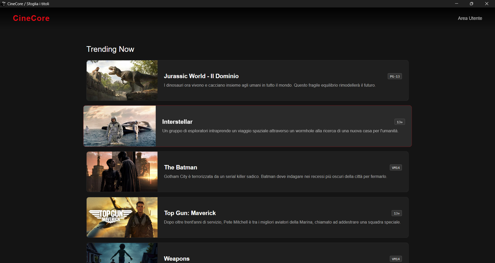
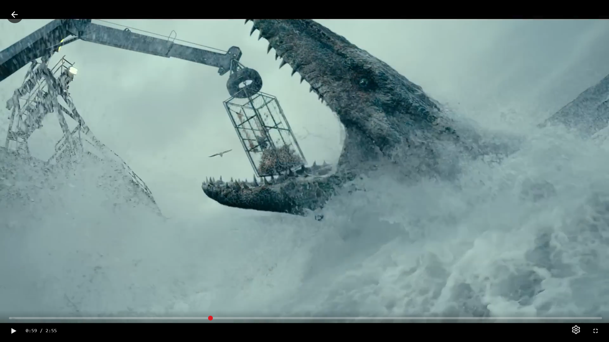
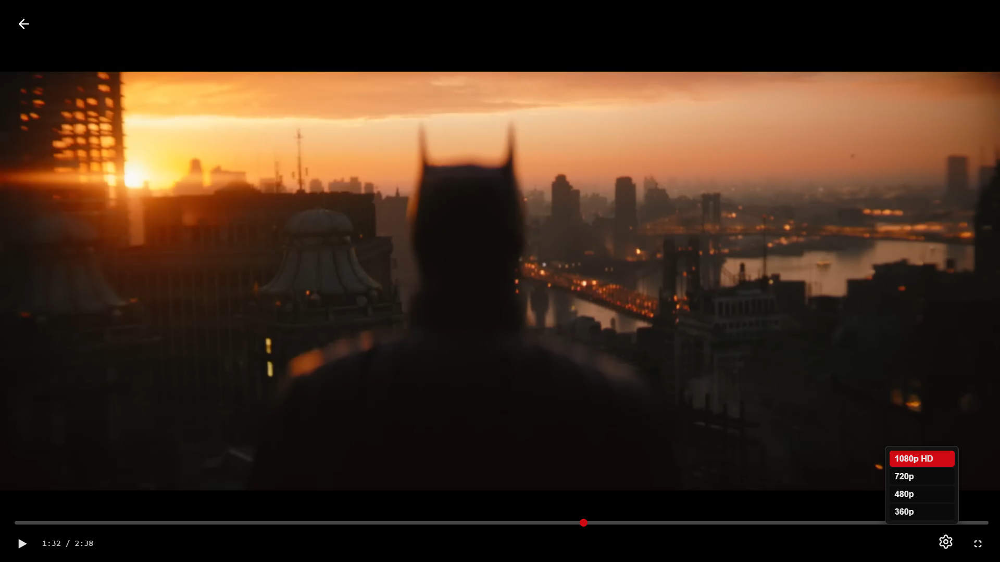
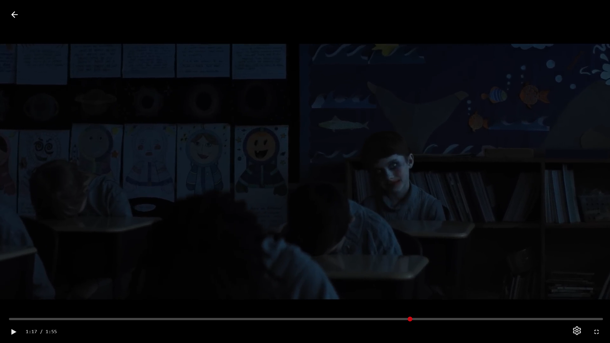
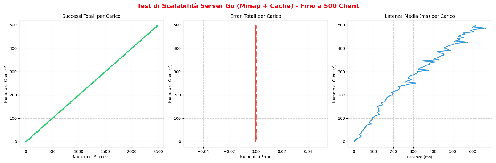
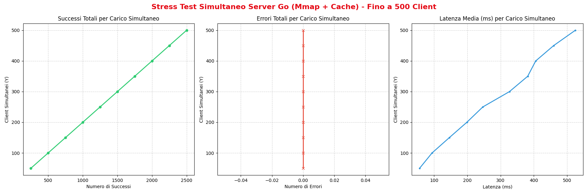
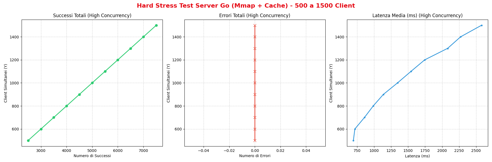
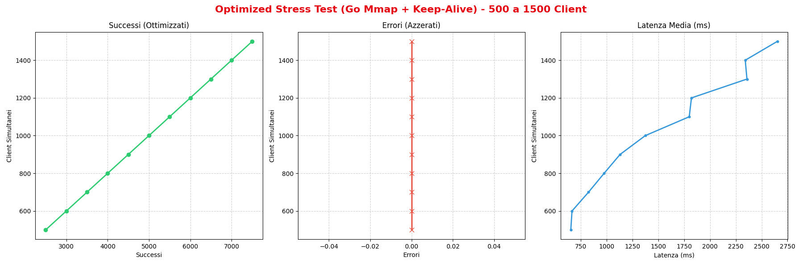
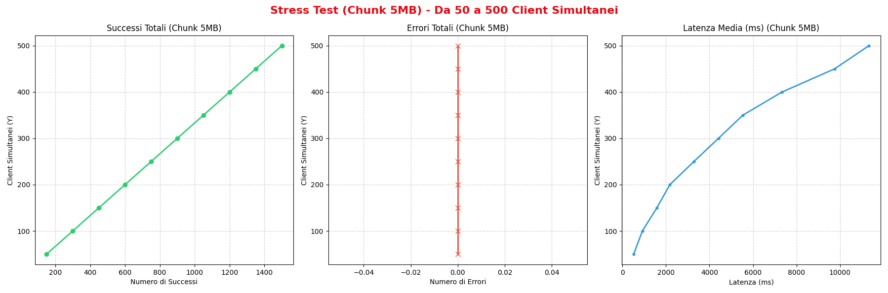

# CineCore

CineCore è una piccola applicazione desktop per sfogliare un catalogo di film e guardare i relativi trailer. L'interfaccia è realizzata con HTML, CSS e JavaScript, viene eseguita in Electron e riceve i video da un server HTTP scritto in Go.

## Funzionalità

- Catalogo con locandine, descrizioni e indicazioni di età.
- Apertura del trailer associato alla scheda selezionata.
- Riproduzione, pausa, barra di avanzamento e visualizzazione della durata.
- Modalità a schermo intero.
- Scelta manuale della qualità video tra 1080p, 720p, 480p e 360p. Quando si cambia risoluzione, la riproduzione riprende dal punto corrente.
- Servizio dei file video dal server Go, separato dall'interfaccia Electron.
- Script opzionale per generare le copie dei video a risoluzione ridotta con FFmpeg.

## Struttura del progetto

```text
CineCore/
├── App/
│   ├── main.js                 # Avvio della finestra Electron
│   ├── preload.js              # Preload associato alla finestra
│   ├── package.json            # Configurazione e dipendenza Electron
│   ├── img/                    # Locandine e logo dell'app
│   └── public/
│       ├── home/               # Catalogo e relativi stili
│       └── player/             # Player e relativi stili
├── Server/
│   ├── main.go                 # Server HTTP per i video
│   └── media/
│       ├── 1080p/              # Video originali ad alta risoluzione
│       ├── 720p/
│       ├── 480p/
│       ├── 360p/
│       └── convert.py          # Generazione delle risoluzioni ridotte
├── img/                        # Screenshot dell'applicazione
├── test/
│   ├── stress-test.py          # Client asincrono per test di carico
│   └── img/                    # Grafici dei test di carico
├── architecture.drawio        # Diagramma architetturale
└── mode.drawio                # Diagramma del flusso di trasferimento
```

### Componenti

**App Electron** — `App/main.js` crea la finestra desktop e carica `App/public/home/index.html`. La finestra usa un preload, disabilita l'integrazione diretta di Node.js nella pagina e abilita il context isolation.

**Catalogo** — La pagina `App/public/home/` mostra il catalogo. I dati dei titoli (nome, descrizione, classificazione, immagine e nome del file video) sono definiti nell'array `movies` in `script.js`. Quando si seleziona una scheda, il nome del trailer viene salvato in `sessionStorage` e viene aperto il player.

**Player** — La pagina `App/public/player/` riproduce il trailer selezionato. I controlli permettono di mettere in pausa, spostarsi nella timeline, entrare a schermo intero e scegliere la risoluzione. La sorgente video è richiesta all'indirizzo `http://localhost:8080/stream/{risoluzione}p/{nome-file}`.

**Server video** — `Server/main.go` serve i file presenti nella cartella `Server/media` sulla porta `8080`, sotto il percorso `/stream/`. Il server va avviato dalla cartella `Server`, così il percorso relativo `./media` punta alla raccolta corretta.

**Conversione video** — `Server/media/convert.py` usa FFmpeg per creare versioni 720p, 480p e 360p da un file sorgente. Mantiene la versione sorgente nella cartella `1080p`; l'output predefinito parte da `weapons_trailer.mp4`.

## Requisiti

- Windows, macOS o Linux.
- Node.js e npm per installare ed eseguire l'app Electron.
- Go per avviare il server video.
- Python 3 e FFmpeg, solo se si desidera usare lo script di conversione.

## Installazione e avvio

Il server video e l'applicazione desktop sono due processi separati. Avviare prima il server e lasciarlo in esecuzione, quindi avviare Electron in un secondo terminale.

### 1. Avviare il server video

Dalla cartella principale del progetto:

```sh
cd Server
go run main.go
```

Il server ascolta su `http://localhost:8080`.

### 2. Installare e avviare l'app desktop

In un altro terminale, dalla cartella principale:

```sh
cd App
npm install
npm start
```

La finestra Electron si apre sul catalogo. Se il server video non è in esecuzione, i trailer non saranno raggiungibili.

## Aggiungere o aggiornare un trailer

1. Inserire la versione originale del video in `Server/media/1080p/`.
2. Generare le versioni a risoluzione ridotta, se necessario:

   ```sh
   cd Server/media
   python convert.py 1080p/nome_trailer.mp4
   ```

   Per un file sorgente collocato altrove, passare il suo percorso come argomento. È possibile scegliere una cartella di output con `--output-dir`.
3. Aggiungere o aggiornare i dati del titolo nell'array `movies` di `App/public/home/script.js`. `videoFileName` deve corrispondere al nome del file presente in ciascuna cartella di risoluzione.
4. Collocare la locandina in `App/img/` e indicarne il percorso nel campo `thumbnail`.

Lo script di conversione richiede che il comando `ffmpeg` sia disponibile nel `PATH`. Genera video H.264 con audio AAC quando presente nella sorgente.













## Stress test

I grafici seguenti documentano prove di carico del server Go durante la distribuzione di video. Le metriche riportate sono il numero di richieste riuscite e fallite e la latenza media, al variare del numero di client. Le prove confrontano scenari di carico crescente, richieste concorrenti, trasferimenti più impegnativi e riuso delle connessioni.

### Carico crescente fino a 500 client

Il carico viene aumentato progressivamente fino a 500 client, che richiedono un video HD per brevi trasferimenti. Il grafico riporta successi, errori e latenza media per ciascun livello di concorrenza; in questa prova si osservano richieste completate senza errori e una latenza crescente con il numero di client.



### Raffica di richieste concorrenti fino a 500 client

In questa prova il numero di client simultanei cresce da 0 a 500, con l'obiettivo di osservare la risposta del server durante l'aumento della concorrenza. Il grafico mostra un aumento dei successi e della latenza al crescere dei client; la serie degli errori rimane a zero nei campioni rappresentati.



### Stress test da 500 a 1.500 client

La concorrenza viene portata oltre il carico iniziale, fino a 1.500 client simultanei. Il test evidenzia l'aumento della latenza alle soglie più elevate, pur mostrando successi ed errori rilevati per ogni livello di carico.



### Riuso delle connessioni con Keep-Alive

Questa prova ripete il carico elevato introducendo il riuso delle connessioni TCP tramite Keep-Alive. Mantenere le connessioni persistenti riduce la necessità di aprirne una nuova per ogni richiesta e mira a contenere l'overhead di connessione, un possibile contributo alla pressione sul percorso di rete. Il grafico confronta successi, errori e latenza per carichi fino a 1.500 client.



### Trasferimento di chunk più grandi

L'ultimo scenario mantiene più client simultanei e richiede un intervallo di 5 MB del video con una richiesta HTTP Range. Un blocco più grande simula trasferimenti più prolungati e permette di osservare il comportamento del server quando ogni risposta richiede più dati; non equivale, da solo, a misurare la riproduzione completa di video di diversa durata.



I risultati sono indicativi e dipendono dall'hardware, dal sistema operativo, dalla rete, dalla cache e dalla configurazione del server e del client di test.